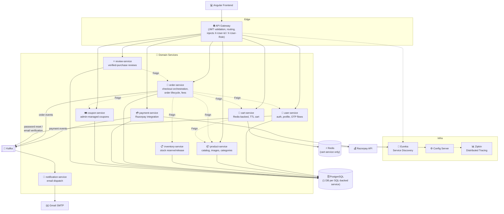

# Cartwise

A full-stack e-commerce platform built as a distributed microservices system — Spring Boot on the backend, Angular on the frontend, Kafka as the event backbone.

Built as a portfolio project to go deep on real production patterns: service discovery, API gateway routing, event-driven communication, circuit breakers, database-per-service isolation, and third-party integrations (Razorpay payments, Gmail SMTP notifications).

---

## Tech Stack

**Backend**

- Java, Spring Boot, Spring Cloud (Gateway, Config Server, Eureka Discovery)
- Spring Data JPA + PostgreSQL (one database per service that needs persistent SQL storage)
- Redis (cart storage — carts are ephemeral with a TTL, not persisted in SQL)
- Apache Kafka (event-driven communication between services)
- Resilience4j (circuit breakers on inter-service calls)
- OpenFeign (typed inter-service HTTP clients)
- Razorpay (payment gateway integration)
- Spring Mail + Gmail SMTP (transactional email)
- Zipkin (distributed tracing)
- Docker Compose (local infrastructure — Kafka, Postgres, Redis, Zipkin, MailHog)

**Frontend**

- Angular 20 (standalone components, signals)
- Angular Material, component SCSS with shared design tokens
- Dark mode across the entire app

---

## Architecture



---

## Services

| Service                  | Responsibility                                                                                                                                                                                                                                                                                                                                                                          |
| ------------------------ | --------------------------------------------------------------------------------------------------------------------------------------------------------------------------------------------------------------------------------------------------------------------------------------------------------------------------------------------------------------------------------------- |
| **api-gateway**          | Single entry point for all client requests. Validates JWTs and injects `X-User-Id` / `X-User-Role` headers into downstream requests so individual services don't re-implement auth.                                                                                                                                                                                                     |
| **eureka-server**        | Service discovery registry. Services register on startup and resolve each other by name instead of hardcoded URLs — this is what makes Feign clients work without static config.                                                                                                                                                                                                        |
| **config-server**        | Centralized configuration for all services.                                                                                                                                                                                                                                                                                                                                             |
| **user-service**         | Registration, login, JWT issuance/refresh, profile management, password reset (OTP via email), email verification (OTP via email), seller onboarding, admin user lookup.                                                                                                                                                                                                                |
| **product-service**      | Product & category CRUD, multi-image upload with local disk storage, per-seller product management, search, SKU-based price lookups.                                                                                                                                                                                                                                                    |
| **cart-service**         | Per-user shopping cart — add/remove/update items, snapshot used at checkout. Backed by **Redis**, not SQL — carts are ephemeral by design (3-day TTL), so there's nothing to persist long-term.                                                                                                                                                                                         |
| **inventory-service**    | Stock levels per SKU. Reserves stock during checkout and releases it on cancellation/failure.                                                                                                                                                                                                                                                                                           |
| **order-service**        | Orchestrates the entire checkout flow across cart, inventory, coupon, user, and product services. Owns the order lifecycle (`PLACED → PROCESSING → SHIPPED → DELIVERED` / `CANCELLED`), fee calculation (delivery fee, COD platform fee), seller earnings aggregation, and publishes order lifecycle events to Kafka. Uses Resilience4j circuit breakers on calls to inventory-service. |
| **payment-service**      | Razorpay integration — creates payment intents, verifies webhook signatures, publishes payment status events.                                                                                                                                                                                                                                                                           |
| **coupon-service**       | Admin-managed coupon system — create/validate/consume coupons (percentage or flat-amount discounts), consumed during checkout via order-service.                                                                                                                                                                                                                                        |
| **review-service**       | Product reviews gated on verified purchases (checks order-service internally before allowing a review).                                                                                                                                                                                                                                                                                 |
| **notification-service** | Kafka consumer for all transactional email — password reset, email verification, and order lifecycle notifications (placed/shipped/delivered/cancelled) — sent via Gmail SMTP with branded HTML templates.                                                                                                                                                                              |

> Every service that needs persistent SQL storage owns its own PostgreSQL database — no shared schema, no cross-service SQL joins. The one exception is **cart-service**, which uses Redis instead of Postgres, since cart data is inherently short-lived (items expire automatically after 3 days of inactivity). Services only ever talk to each other through their public APIs (via Feign) or asynchronously through Kafka.

---

## Key Features

- **Distributed checkout saga** — cart snapshot, inventory reservation, coupon consumption, and payment orchestration across multiple services with rollback on failure
- **Event-driven order lifecycle** — Kafka-based state sync between order-service and payment-service; automatic inventory release on cancellation or failed payment
- **Razorpay payment integration** — real payment intents, signature-verified webhooks
- **Rule-based fee calculation** — flat delivery fee under a configurable order threshold, separate COD platform fee, computed identically on the frontend and backend
- **Verified-purchase product reviews** — write access gated on an actual completed order for that SKU
- **Seller dashboard** — product management with multi-image upload, stock management, and an earnings view with a category revenue breakdown
- **Admin order management** — role-gated order status transitions with lifecycle guards (can't skip from PROCESSING straight to DELIVERED)
- **Automated transactional email** — password reset, email verification, and order status changes, all as branded HTML emails dispatched asynchronously via Kafka
- **Full dark mode** across the storefront, seller dashboard, and admin pages

---

## Frontend

Angular SPA covering the full buyer, seller, and admin experience: catalog browsing with search/filtering, product details with an image slider, cart and checkout, order history, a seller dashboard (product CRUD, inventory, earnings), and admin tooling for order fulfillment and coupon management.

---

## Getting Started

This is a multi-module Maven backend (one module per service) plus a separate Angular frontend. All local infrastructure — Postgres, Kafka, Redis, Zipkin, and MailHog — runs via a single `docker-compose.yml`, so you don't need to install or configure any of that manually.

### Prerequisites

- **Java 21+** and **Maven**
- **Node.js 18+** and **npm**
- **Docker** and **Docker Compose**
- A **Gmail account** with an **App Password** generated (see below) — required for password reset, email verification, and order notification emails to actually send
- A **Razorpay account** (test mode is fine) with an API key pair — required for the online payment flow. Cash on Delivery works without this.

### 1. Clone the repo

```bash
git clone <your-repository-url> cartwise
cd cartwise
```

### Config repo

`config-server` serves per-service configuration from a **git repository** at `backend/cartwise-config-repo` (override with the `CONFIG_REPO_URI` environment variable). It holds a shared `application.yml` plus one `<service-name>.yml` per service: server ports, database URLs, the gateway routes, the JWT signing key and so on.

This folder is **git-ignored by the main repository** because it contains secrets, and config-server needs it to be its own git repo with at least one commit. If you set the project up fresh, recreate it (`git init -b main`, add the files, commit). Remember that config-server reads **committed** changes, so commit after editing.

Things to know:

- `jwt.secret` — a Base64 signing key shared by `api-gateway` and `user-service`. Generate your own with `openssl rand -base64 48` for anything beyond local development.
- Razorpay (`payment-service`) reads `RAZORPAY_KEY_ID`, `RAZORPAY_KEY_SECRET` and `RAZORPAY_WEBHOOK_SECRET` from the environment. The defaults are placeholders, so Cash on Delivery works but online payments need real test keys.
- Service ports: gateway `8080`, user `8091`, product `8082`, cart `8083`, inventory `8084`, notification `8085`, order `8086`, payment `8087`, coupon `8088`, review `8089`. Services find each other through Eureka, so these only need to be unique. If a port is taken on your machine, change it here and commit.
- Every service advertises `localhost` to Eureka (single-machine setup). Auto-detected IPs can pick a virtual adapter (WSL, Hyper-V, VPN) that other services can't reach.

### 2. Free up ports

The compose file binds services to fixed host ports. The `postgres-user` and `postgres-product` containers use `15432` and `15433` (not `5432`/`5433`) so they don't collide with a PostgreSQL instance installed on your machine. The other databases use `5434`–`5438`.

Make sure nothing else on your machine is using `9092` (Kafka), `6379` (Redis), `9411` (Zipkin), `8025`/`1025` (MailHog), `8761` (Eureka), `8888` (config-server) or any of the service ports above. A port clash shows up as "Port NNNN was already in use" in that service's log.

### 3. Create the external Docker volumes

The compose file marks every Postgres volume as `external: true`, which means Docker expects them to already exist — `docker-compose up` will fail with a "volume not found" error on a fresh machine unless you create them first. Run this once:

```bash
docker volume create cartwise_postgres-user-data
docker volume create cartwise_postgres-product-data
docker volume create cartwise_postgres-inventory-data
docker volume create cartwise_postgres-order-data
docker volume create cartwise_postgres-payment-data
docker volume create cartwise_postgres-review-data
docker volume create cartwise_postgres-coupon-data
```

### 4. Start the infrastructure

```bash
docker-compose up -d
```

This brings up:

- 7 isolated Postgres instances (one per SQL-backed service, ports `15432`, `15433` and `5434`–`5438`)
- Kafka (port `9092`)
- Redis (port `6379`) — backs cart-service
- Zipkin (port `9411`) — distributed tracing dashboard at `http://localhost:9411`
- MailHog (ports `1025`/`8025`) — a local SMTP catcher. **Not used for real email in this setup** since `notification-service` is configured to send through Gmail SMTP directly (see below) — MailHog is included for anyone who wants to point `notification-service` at it instead for offline testing, but it's not required.

Give the containers a few seconds to finish initializing (especially the Postgres instances) before starting any Spring Boot service — a service that tries to connect before its database is ready will fail to start.

### 5. Configure environment variables

Set these before starting the relevant services (shell export, IDE run config, or a `.env` file depending on your setup):

| Variable               | Used by              | Notes                                                                                                                                                                                        |
| ---------------------- | -------------------- | -------------------------------------------------------------------------------------------------------------------------------------------------------------------------------------------- |
| `GMAIL_USERNAME`       | notification-service | The full Gmail address you're sending from                                                                                                                                                   |
| `GMAIL_APP_PASSWORD`   | notification-service | 16-character App Password — **not** your regular Gmail password. Requires 2-Step Verification enabled on the account first (Google Account → Security → 2-Step Verification → App passwords) |
| `razorpayKeyId`        | frontend             | Your Razorpay **public** key ID, set in `frontend/src/environments/environment.ts`                                                                                                           |

Razorpay's secret key and webhook secret are configured directly in `payment-service`'s `application.yml` — check that file for the exact property names before running the online payment flow. If you skip Razorpay setup entirely, Cash on Delivery orders still work end-to-end.

The Postgres credentials (`cartwise` / `cartwise@postgres` by default, per the compose file) and database names (`user_service_db`, `product_service_db`, etc.) are already wired up to match each service's `application.yml` — no manual database creation needed.

### 6. Start the backend, in this order

From the parent directory, each module can be run individually with Maven:

```bash
# 1. Config Server — everything else reads its config from here
cd config-server && mvn spring-boot:run

# 2. Eureka Server — service discovery registry
cd eureka-server && mvn spring-boot:run
```

Wait until both are up (Eureka's dashboard at `http://localhost:8761` should be reachable), then start the domain services — order doesn't strictly matter between these, but starting `user-service` and `product-service` early avoids startup errors in services that call them:

```bash
cd user-service && mvn spring-boot:run
cd product-service && mvn spring-boot:run
cd cart-service && mvn spring-boot:run
cd inventory-service && mvn spring-boot:run
cd coupon-service && mvn spring-boot:run
cd payment-service && mvn spring-boot:run
cd review-service && mvn spring-boot:run
cd order-service && mvn spring-boot:run
cd notification-service && mvn spring-boot:run
```

Finally, start the gateway — it's the single entry point the frontend talks to:

```bash
cd api-gateway && mvn spring-boot:run
```

Confirm everything registered correctly by checking `http://localhost:8761` — you should see all nine domain services plus the gateway listed as `UP`.

### 7. Start the frontend

```bash
cd frontend
npm install
npm start
```

Set your Razorpay public key in `frontend/src/environments/environment.ts`:

```ts
razorpayKeyId: 'your_razorpay_key_id_here',
```

The app should now be reachable at `http://localhost:4200`, talking to the gateway at `http://localhost:8080`.

### 8. Seed some initial data

Fresh databases start empty. To get a working storefront:

1. Register a user via the frontend, then manually promote it to `ADMIN` in `user_service_db` (or via whatever admin-creation endpoint your `user-service` exposes) — categories and coupons require the `ADMIN` role to create.
2. Create at least one product category.
3. (Optional) Create a coupon via the admin coupon management page.
4. Register a second account and use "Become a Seller" to list a product against that category.
5. Add stock via the seller dashboard's inventory management before trying to purchase it — orders will fail inventory reservation otherwise.

At that point the full flow — browsing, cart, checkout, payment (or COD), order tracking, reviews, and email notifications — should all work end-to-end.

### Stopping everything

```bash
docker-compose down
```

This stops the containers without deleting the external volumes, so your data survives a restart. To wipe everything and start completely fresh, also run `docker volume rm` on each of the volumes created in step 3.

---

## About

Cartwise demonstrates production-grade microservices patterns end-to-end: service discovery, event-driven architecture, distributed transactions, and third-party payment/email integrations.
