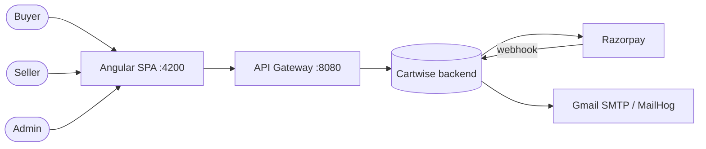
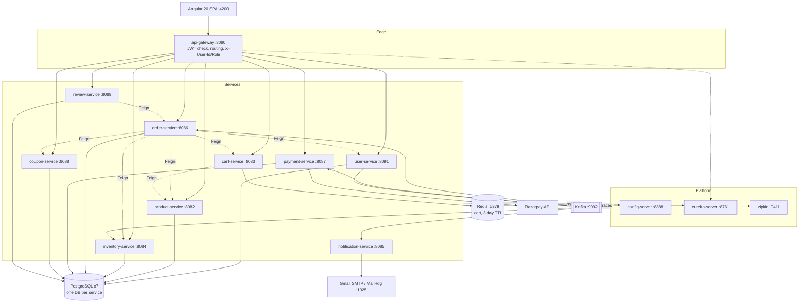
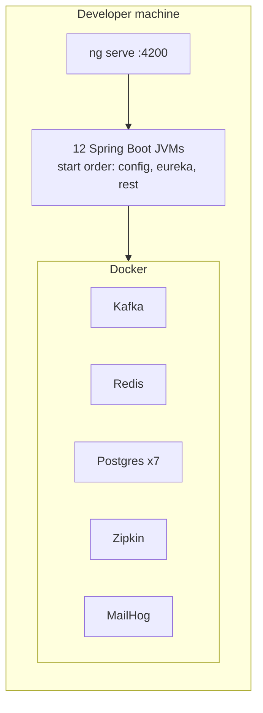

# Cartwise — High-Level Design (HLD)

## 1. Goals

- Event-driven e-commerce platform split into independently deployable microservices.
- One database per SQL-backed service; no cross-service joins.
- Single entry point (gateway) that owns authentication; downstream services trust its headers.
- Asynchronous side effects (email, stock deduction, payment sync) via Kafka.

## 2. System context

## 3. Component architecture

## 4. Services and data ownership

| Service | Port | Store | Responsibility |
|---|---|---|---|
| api-gateway | 8080 | - | Routing, JWT validation, header injection |
| config-server | 8888 | git repo | Central configuration |
| eureka-server | 8761 | - | Service discovery |
| user-service | 8091 | Postgres `user_service_db` | Auth, JWT, profile, addresses, wishlist, seller onboarding, OTP |
| product-service | 8082 | Postgres `product_service_db` + disk | Catalog, categories, images, search |
| cart-service | 8083 | Redis | Per-user cart, 3-day TTL |
| inventory-service | 8084 | Postgres `inventory_service_db` | Stock, reserve / release / deduct |
| notification-service | 8085 | - | Kafka consumer, email dispatch |
| order-service | 8086 | Postgres `order_service_db` | Checkout orchestration, order lifecycle, fees |
| payment-service | 8087 | Postgres `payment_service_db` | Razorpay intents, webhook, payment events |
| coupon-service | 8088 | Postgres `coupon_service_db` | Coupon validate / consume |
| review-service | 8089 | Postgres `review_service_db` | Verified-purchase reviews |

## 5. Communication styles

| Style | Used for | Why |
|---|---|---|
| REST via gateway | Client to services | Single secured entry point |
| Feign (sync, via Eureka) | Order to cart / inventory / coupon / user / product; cart to product; review to order | Needs an immediate answer during checkout |
| Kafka (async) | Email, stock deduction / release, order and payment state sync | Decouples side effects; retry-friendly |
| Resilience4j circuit breaker | `inventoryService` calls from order-service | Fail fast with fallback when inventory is down |

## 6. Kafka topics

| Topic | Producer | Consumer | Purpose |
|---|---|---|---|
| `order-events-topic` | order-service | payment-service | Order placed; payment record is created |
| `payment-events-topic` | payment-service | order-service | Payment success / failure |
| `order-paid-topic` | order-service | inventory-service | Deduct reserved stock |
| `order-cancelled-topic` | order-service | inventory-service | Release reserved stock |
| `order-notification-topic` | order-service | notification-service | Order lifecycle emails |
| `notificationTopic` | order-service | notification-service | Order placed notification |
| `email-verification-topic` | user-service | notification-service | Verification OTP email |
| `password-reset-topic` | user-service | notification-service | Reset OTP email |

## 7. Security

- Gateway validates the JWT (shared Base64 `jwt.secret`) and injects `X-User-Id` / `X-User-Role`.
- Public routes skip the auth filter: register, login, refresh, forgot / reset password, product GETs, inventory GET, review GET by product.
- Admin screens are role-guarded in the SPA (`authGuard('ADMIN')`).
- Razorpay webhooks are signature-verified; non-2xx responses make Razorpay retry.
- Secrets live in `cartwise-config-repo` (git-ignored) or environment variables.

## 8. Reliability patterns

- **Saga with compensation** in checkout: if a step fails after stock is reserved, stock is released.
- **Idempotent consumers**: a duplicate payment-confirmed event is ignored (`COMPLETED` is a no-op).
- **Circuit breaker** around inventory reservation with a fallback.
- **Eventual consistency** between order, payment and inventory via Kafka.

## 9. Observability

Zipkin distributed tracing (trace IDs appear in each service log); Actuator `/health` on each service.

## 10. Deployment (local)

