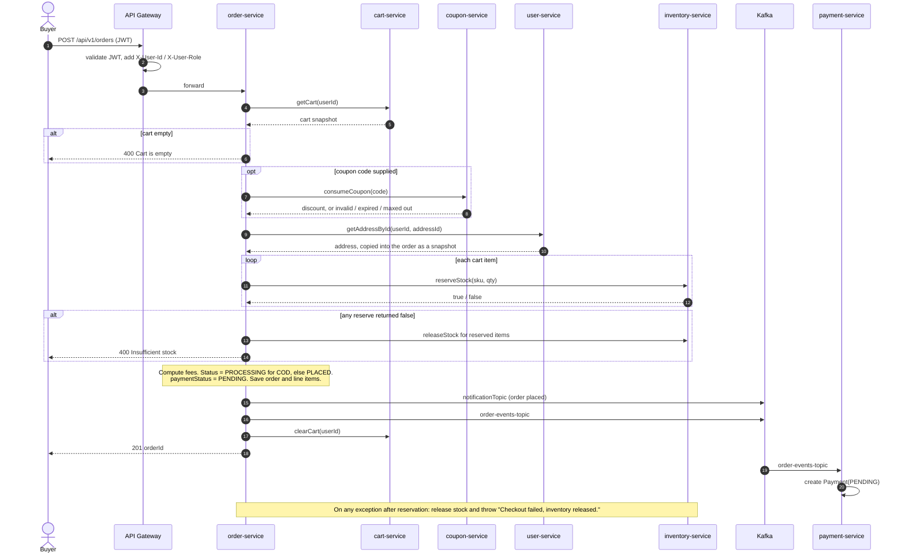
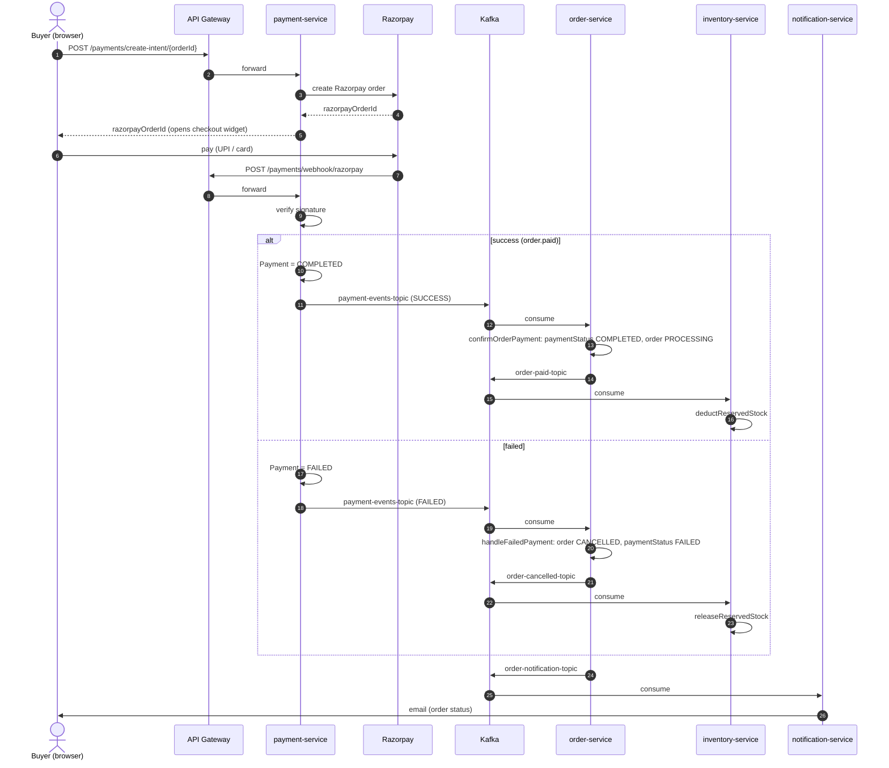
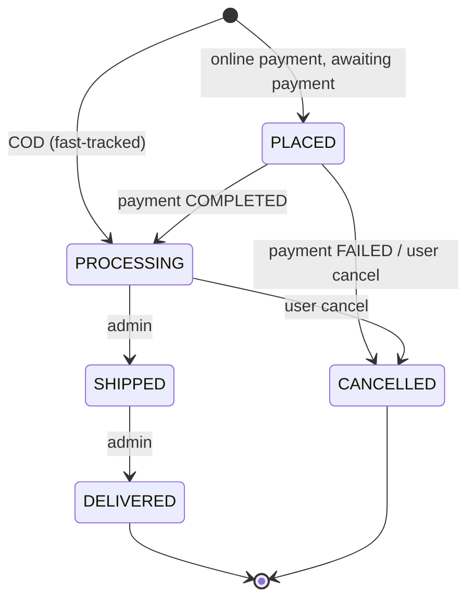
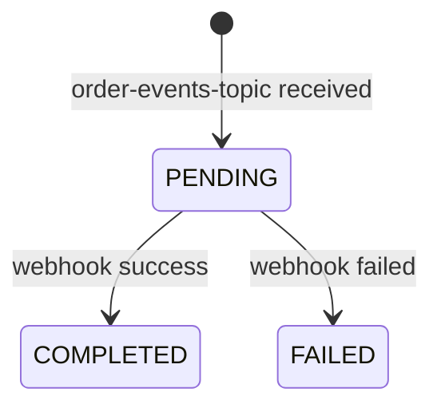
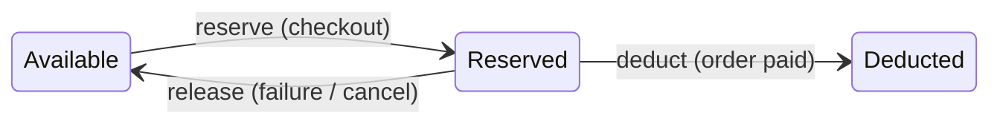
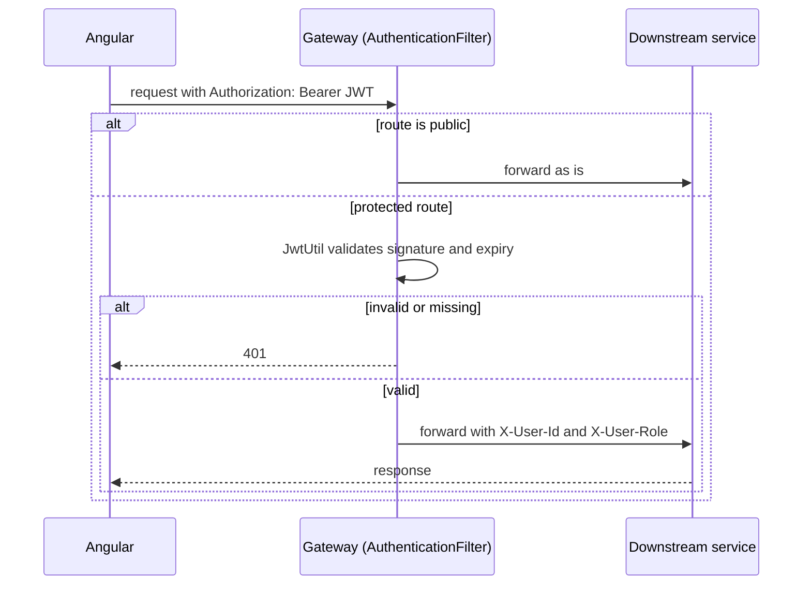
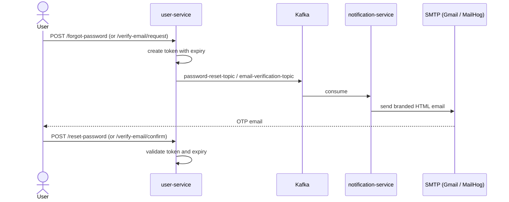
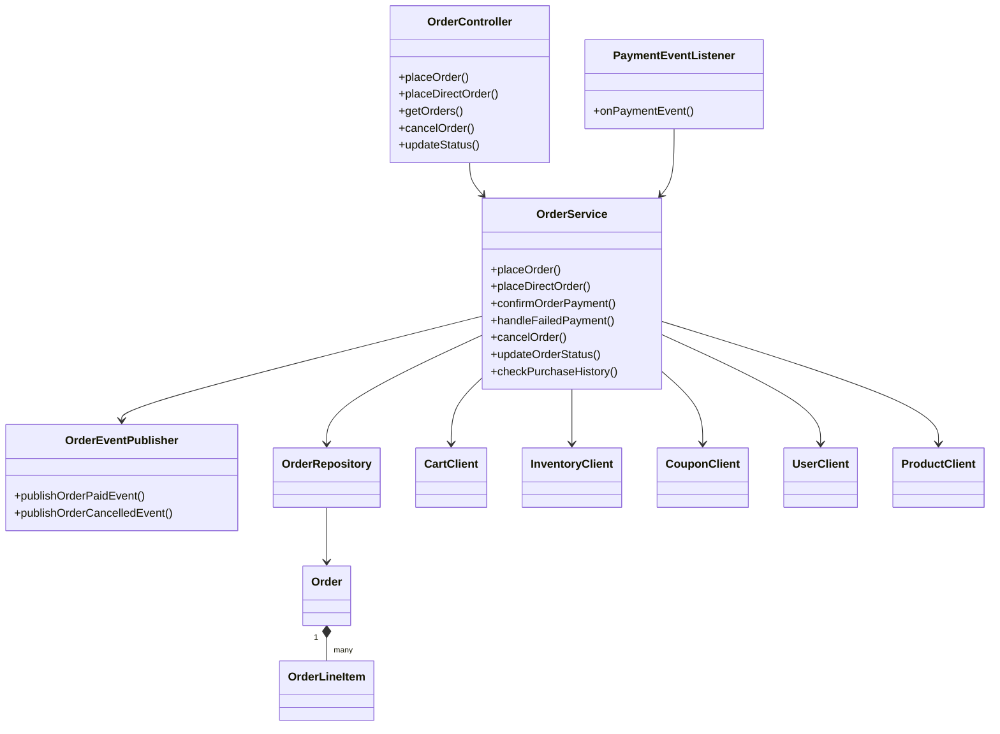

# Cartwise — Low-Level Design (LLD)

Detailed design of the data model, API surface, checkout saga, payment flow and state machines.
Derived from the code in `backend/*-service`.

## 1. Data model (per-service databases)

Services never join across databases; cross-service references (`userId`, `skuCode`,
`orderId`) are plain string / UUID values resolved through Feign calls.

```mermaid
erDiagram
    %% user-service
    USER ||--o| SELLER_PROFILE : has
    USER ||--o{ EMAIL_VERIFICATION_TOKEN : has
    USER ||--o{ PASSWORD_RESET_TOKEN : has
    USER ||--o{ ADDRESS : owns
    USER ||--o{ WISHLIST_ITEM : saves
    USER {
        UUID id PK
        string username
        string email
        string password
        string firstName
        string lastName
        string phoneNumber
        boolean isActive
        boolean emailVerified
        Role role
    }
    SELLER_PROFILE {
        UUID id PK
        string shopName
        string shopDescription
    }
    ADDRESS {
        UUID id PK
        string userId
        string street
        string city
        string state
        string zipCode
        string country
    }
    WISHLIST_ITEM {
        UUID id PK
        string userId
        string skuCode
    }

    %% product-service
    CATEGORY ||--o{ PRODUCT : contains
    CATEGORY {
        string id PK
        string name
        string description
    }
    PRODUCT {
        UUID id PK
        string name
        decimal price
        string skuCode
        string sellerId
        string shopName
        list imageUrls
    }

    %% order-service
    ORDER ||--|{ ORDER_LINE_ITEM : contains
    ORDER {
        UUID id PK
        string orderNumber
        string userId
        OrderStatus orderStatus
        PaymentStatus paymentStatus
        PaymentMethod paymentMethod
        decimal totalAmount
        embedded shippingAddress
    }
    ORDER_LINE_ITEM {
        UUID id PK
        string skuCode
        decimal price
        int quantity
    }

    %% other services
    INVENTORY {
        UUID id PK
        string skuCode
        int availableQuantity
        int reservedQuantity
    }
    PAYMENT {
        string id PK
        string orderId
        decimal amount
        PaymentStatus status
        string paymentGatewayTransactionId
    }
    COUPON {
        UUID id PK
        string code
        DiscountType discountType
        decimal discountValue
        date expirationDate
        int usageLimit
        int usageCount
    }
    REVIEW {
        UUID id PK
        string productId
        string userId
        int rating
        string comment
    }
```

Logical (non-FK) links: `ORDER_LINE_ITEM.skuCode` = `PRODUCT.skuCode` = `INVENTORY.skuCode`;
`PAYMENT.orderId` = `ORDER.id`; `REVIEW.productId` = `PRODUCT.id`.

## 2. REST API surface (through gateway `:8080`)

| Service | Method and path | Auth |
|---|---|---|
| user | `POST /api/v1/users/register`, `/login`, `/refresh`, `/forgot-password`, `/reset-password` | public |
| user | `GET/PUT /api/v1/users/profile`, `GET /me`, `POST /verify-email/request`, `/verify-email/confirm`, `/become-seller` | JWT |
| user | `POST /api/v1/users/admin/create`, `GET /admin/lookup` | ADMIN |
| user | `GET/POST /api/v1/users/addresses`, `GET /addresses/{id}` | JWT |
| user | `GET /api/v1/wishlist`, `POST /wishlist/toggle` | JWT |
| product | `GET /api/v1/products`, `/{id}`, `/search`, `/category/{id}`, `/sku/{sku}`, `/sku/{sku}/price`, `/categories`, `/exists/{sku}`, `/images/**` | public |
| product | `POST /api/v1/products`, `PUT/DELETE /{id}`, `POST /images` (multipart), `GET /seller/{id}` | JWT (seller) |
| product | `POST /api/v1/products/categories` | ADMIN |
| inventory | `GET /api/v1/inventory/{sku}` | public |
| inventory | `POST /api/v1/inventory/add` | SELLER or ADMIN |
| inventory | `POST /reserve`, `/release`, `/deduct` | JWT / internal (called by order-service) |
| cart | `GET /api/v1/carts`, `POST /add`, `POST /decrease`, `DELETE /items/{sku}`, `DELETE /` | JWT |
| coupon | `POST /api/v1/coupons`, `GET /api/v1/coupons`, `GET /validate/{code}`, `POST /consume/{code}` | JWT (create / list: ADMIN) |
| order | `POST /api/v1/orders` (cart checkout), `POST /direct` (buy now), `GET /`, `GET /{id}` | JWT |
| order | `PUT /{id}/cancel`, `PUT /{id}/pay`, `GET /seller-summary`, `GET /internal/verify-purchase` | JWT / internal |
| order | `GET /all`, `PUT /{id}/status` | ADMIN |
| payment | `POST /api/v1/payments/create-intent/{orderId}` | JWT |
| payment | `POST /api/v1/payments/webhook/razorpay` | Razorpay signature |
| review | `GET /api/v1/reviews/product/{productId}` | public |
| review | `POST /api/v1/reviews` | JWT, verified purchase |

## 3. Checkout saga — cart checkout (`OrderService.placeOrder`)

Wrapped in `@Transactional` and a Resilience4j `@CircuitBreaker("inventoryService")`.

`POST /direct` (`placeDirectOrder`) is the same saga for a single SKU, with the price looked up
from product-service and no cart read or clear.

**Fees:** a flat delivery fee applies below a configurable order threshold, and a separate
platform fee applies to COD. The same rule is implemented on the frontend and the backend.

## 4. Online payment flow (Razorpay)

Idempotency: `confirmOrderPayment` returns early if payment is already `COMPLETED`, and the
payment webhook ignores a repeat `COMPLETED`. A non-2xx webhook response makes Razorpay retry.

## 5. State machines

### Order status

Guards in `OrderService`: SHIPPED and DELIVERED orders cannot be cancelled; admin may only set
`SHIPPED` (from `PROCESSING`) or `DELIVERED` (from `SHIPPED`); a cancelled order cannot be cancelled twice.

### Payment status

`REFUNDED` exists in the `PaymentStatus` enum but no code path sets it yet.

### Inventory (stock per SKU)

## 6. Authentication and request pipeline

Services read `X-User-Id` / `X-User-Role` and never parse the JWT themselves. Tokens are refreshed
via `POST /api/v1/users/refresh`.

## 7. Email flows (user-service to notification-service)

## 8. Internal class layout (typical service)

Each Spring Boot service follows the same layering, shown here for order-service.

Layering convention: `controller` (REST) to `service` (business logic, transactions) to `repository`
(Spring Data JPA); `client` (Feign interfaces), `listener` (Kafka consumers), `dto`, `entity`,
`exception` (global handler).
