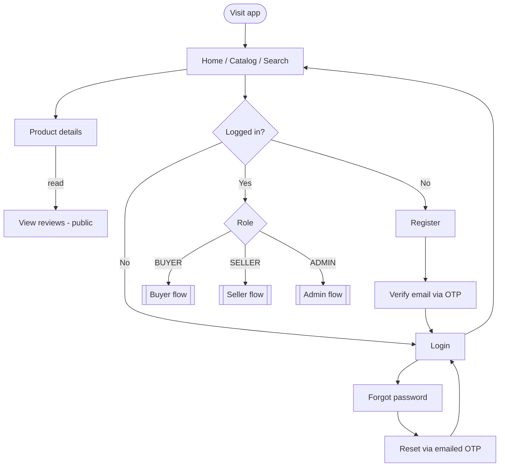
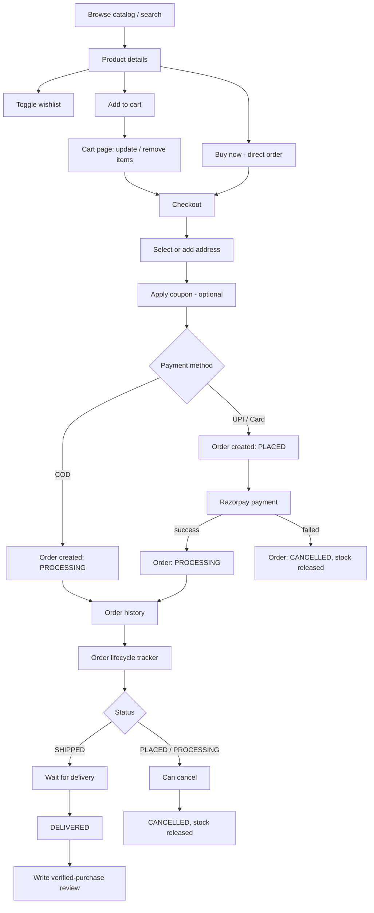
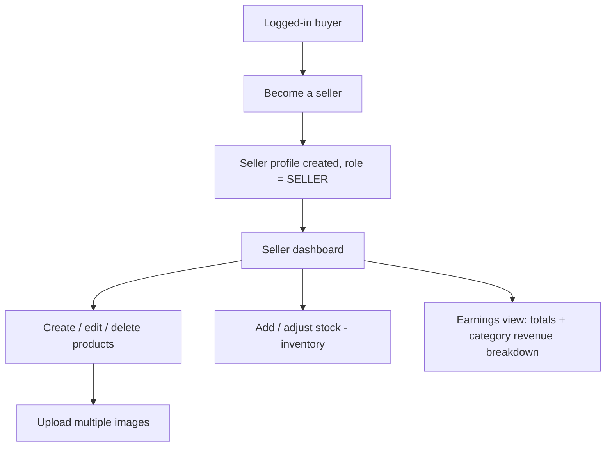
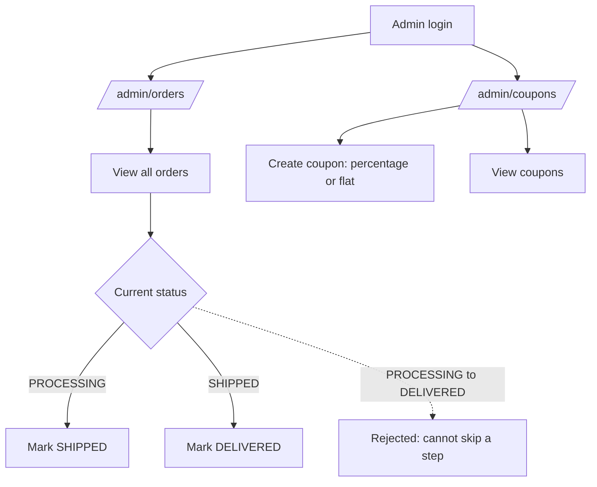

# Cartwise — User Flows

Three personas use the app: **Buyer**, **Seller** and **Admin**. Roles come from the JWT; the
API gateway injects `X-User-Id` / `X-User-Role` into every authenticated request.

## 1. Overall navigation (all personas)

Public (no login): home, catalog, product details, search, category view, reading reviews.

## 2. Buyer flow — browse to delivery

Emails sent at: registration (verify), password reset, order placed, shipped, delivered, cancelled.

## 3. Seller flow

## 4. Admin flow

## 5. Frontend routes

| Route | Access | Purpose |
|---|---|---|
| `/login`, `/register` | public | Auth (no navbar/footer) |
| `/`, `/catalog`, `/search`, `/category/:id`, `/product/:id` | public | Browse |
| `/cart`, `/checkout`, `/addresses` | user | Buy |
| `/orders`, `/order-lifecycle/:id` | user | Order history and tracking |
| `/wishlist`, `/profile` | user | Account |
| `/become-seller`, `/dashboard` | user / seller | Seller onboarding and dashboard |
| `/admin/orders`, `/admin/coupons` | ADMIN (route guard) | Fulfilment and coupons |
